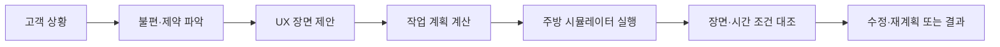

# 2026 창원대·LG AX 해커톤 공개 저장소 조사

조사 기준: **2026-08-01~2026-10-08 KST**. 공개 GitHub의 저장소 설명·README·소스·커밋·Issue/PR·Actions를 읽었다. 확인일의 고정 commit을 사용했으며 다른 저장소의 코드는 실행하지 않았다. 이 문서는 날짜별 조사 결과이고 공식 참가팀 명단이나 지속적인 기술 규칙의 정본이 아니다.

**우리 저장소를 제외하고 이번 창원대·LG AX 대회를 명시한 공개 저장소는 1개를 찾았다.** LG 키친 관련 업무 저장소 2개도 확인했지만 참가 근거가 없어 분리했다. 비공개 저장소·검색 미색인·다른 이름의 저장소가 있으므로 전체 참가팀 수나 다른 팀의 진척을 이 숫자로 판단하지 않는다. 1차 선정·정식 접수는 확인하지 않았다.

## 1. 참가를 명시한 저장소

| 항목 | 확인 내용 |
|---|---|
| 저장소 | [Jae-ik/lg-ax-kitchen-agent](https://github.com/Jae-ik/lg-ax-kitchen-agent) |
| 팀·테마 | README의 **독립선언문 / Theme B / UX 시나리오 설계 Agent** |
| GitHub 활동 | 생성 9/24, 공개 기본 브랜치의 커밋 67개(9/24~10/1), 마지막 push 10/1 |
| 고정 소스 | `f24db3497a00a90efc2941d69fd9a7ec301685dd` / master |
| 공개 개발 흔적 | 67커밋의 GitHub author는 Jae-ik 1계정. 팀 인원·실제 분담의 증거는 아니다. |
| 확인 범위 | 코드와 저장 산출물의 정적 확인. 설치·실행·기기 연결·테스트 결과 재현은 미실행. |

참가 근거는 [고정 README](https://github.com/Jae-ik/lg-ax-kitchen-agent/blob/f24db3497a00a90efc2941d69fd9a7ec301685dd/README.md), 개발 이력은 [커밋 목록](https://github.com/Jae-ik/lg-ax-kitchen-agent/commits/master/)과 [수집 메타데이터](../../evals/repository-research/20261008/evidence.json)를 따른다. 제작 기록에 적힌 9/21 제출·9/22 설명회 경험은 작성자의 보고이며 우리가 주최 측 자료로 확인한 사실은 아니다.

### 주제와 사용 방식

**기획자가 고객의 생활 상황을 넣으면, 편리한 주방 경험을 장면별로 설계하고 그 흐름이 가능한지 시뮬레이션으로 확인하는 Agent**다. 초기의 가족 손맛 재현 구상에서 UX 기획 직무를 수행하는 구조로 방향을 바꿨다고 기록한다. 기획자가 쓰는 설계 층과 가전 동작을 시험하는 실행 층을 구분했다. [제작 과정](https://github.com/Jae-ik/lg-ax-kitchen-agent/blob/f24db3497a00a90efc2941d69fd9a7ec301685dd/제작과정_기록.md)

| 입력 상황 | 설계·검증하려는 경험 |
|---|---|
| 야근한 1인 가구 | 남은 재료로 빠르게 식사를 준비하고 세척까지 끝내기 |
| 맞벌이 가구·퇴근길 | 필요한 재료와 귀가 시간을 고려해 조리·장보기 흐름 짜기 |
| 알레르기가 있는 가구 | 재료·구매 확인 조건을 반영해 적합한 조리 흐름 구성하기 |

공개 산출물은 네 고객 상황의 JSON·실행 trace·텍스트 시나리오다. 성공 표시와 수치는 저장된 실행 결과로 확인한 것이며 실제 기기의 측정값이나 이번 조사에서 재실행한 결과가 아니다. [시나리오 산출물](https://github.com/Jae-ik/lg-ax-kitchen-agent/blob/f24db3497a00a90efc2941d69fd9a7ec301685dd/scenarios.json)

### 구현은 어떻게 되어 있나

- **설계 Skill 4개:** 상황 해석, 시나리오 초안, 서비스 흐름 설계, 경험 검증. **실행 Skill 7개:** 재고·레시피·메뉴·조달·준비·조리 수렴·후처리. 등록된 Skill과 도메인별 Task의 입출력을 연결한다. [Skill 인터페이스](https://github.com/Jae-ik/lg-ax-kitchen-agent/blob/f24db3497a00a90efc2941d69fd9a7ec301685dd/skills/base.py), [설계 Skill](https://github.com/Jae-ik/lg-ax-kitchen-agent/blob/f24db3497a00a90efc2941d69fd9a7ec301685dd/skills/design_skills.py)
- **호출 순서를 계산한다:** 목표에서 필요한 사실을 역으로 찾고 전제조건 순서로 정렬한다. 이미 충족된 작업은 제외하고, 만들 수 없는 사실이나 순환은 오류로 처리한다. 범용 최적화 탐색기는 아니며 제공된 도메인 작업 안에서 결정하는 플래너다. [planner.py](https://github.com/Jae-ik/lg-ax-kitchen-agent/blob/f24db3497a00a90efc2941d69fd9a7ec301685dd/planner.py)
- **불성립 시 재계획:** 진단된 원인과 완화 가능한 조건을 이용해 다시 실행하고 시도들을 비교한다. 조리·세척의 시뮬레이션 결과와 시나리오의 예상 지표·시간 예산을 대조한다. [run_design.py](https://github.com/Jae-ik/lg-ax-kitchen-agent/blob/f24db3497a00a90efc2941d69fd9a7ec301685dd/run_design.py)
- **LLM의 역할을 한정한다:** 기본 경로는 준비된 장면 생성 함수와 코드 판단으로 실행된다. 별도 경로에서는 LLM이 장면을 제안하고 형식·기능 범위·실행 가능성을 코드로 검사한다. 자연어 입력·설명에도 Claude 호출 경로가 있으나 모든 경우의 실호출 성공을 이번 조사에서 확인한 것은 아니다. [llm_design.py](https://github.com/Jae-ik/lg-ax-kitchen-agent/blob/f24db3497a00a90efc2941d69fd9a7ec301685dd/llm_design.py), [thinq.py](https://github.com/Jae-ik/lg-ax-kitchen-agent/blob/f24db3497a00a90efc2941d69fd9a7ec301685dd/thinq.py)

따라서 LLM에게 좋은 장면을 요청하는 것에 더해 **장면을 실행 가능한 단계로 연결하고 검사하는 기능**이 있다. 다만 기본 장면·고객 상황·기기 모델은 사전 정의된 범위에 의존한다. 범위를 벗어난 고객 요청에서 얼마나 새롭고 적절한 시나리오를 만드는지는 별도 평가가 필요하다는 해석이다.

### 하네스·협업 방식

| 구분 | 공개 소스에서 확인한 것 | 확인하지 못한 것 |
|---|---|---|
| 실행 추적 | GOAL→PLAN→SKILL/실행→검증→결과 trace·JSON | 실제 클라우드 상시 운영·실기기 접속 |
| 개발 검사 | `check_all.py`의 회귀·선언/구현 일치·물리·플래너·재사용·민감도 등 검사 묶음 | 우리가 재현한 통과 결과·독립 사용자 평가 |
| 작업 의도·실패 | 제작과정 문서의 방향 변경·실패·수정·불확실성 기록 | 네 명 역할 배정·각 AI의 별도 재개 문서 |
| GitHub 운영 | 기본 브랜치 1개, 수집 시 전체 Issue 0 / PR 0 / Actions workflow 0 / run 0 | 비공개 보드·외부 협업/검수 과정 |
| Agent 지침·제출 Skill | `AGENT_정의서.md`, Python Skill 코드 | 고정 공개 tree의 `AGENTS.md`, `CLAUDE.md`, `SKILL.md` |

**제품의 실행·검사 하네스는 있고, 우리와 같은 PM 배정·자기보고·PR 인수 하네스는 공개 자료에서 확인되지 않는다.** 공개 Git 기록은 한 계정의 직접 커밋 방식에 가깝다. 제작 문서는 Claude Code 활용과 Slack 단위 알림을 설명하지만 그 운영은 작성자 보고다. `AGENT_정의서.md`는 참가작 설명 문서이며 코딩 AI 행동 지침 `AGENTS.md`와 구분한다. [검사 진입점](https://github.com/Jae-ik/lg-ax-kitchen-agent/blob/f24db3497a00a90efc2941d69fd9a7ec301685dd/check_all.py), [정의서](https://github.com/Jae-ik/lg-ax-kitchen-agent/blob/f24db3497a00a90efc2941d69fd9a7ec301685dd/AGENT_정의서.md)

### 강점과 공개 자료의 한계

강점은 설계 장면을 실행 로그와 이어 놓은 점, 원인에 따른 재계획, 공개 레시피 자료, 실패·경계 조건을 남긴 점이다. 우리 심사 준비에도 입력부터 도구·검사까지의 흔적을 한 번에 보여주는 방식이 참고된다.

한계는 가전·배송·위치 모델이 시뮬레이션이라는 점과 효과의 기준선이 코드 가정에 의존한다는 점이다. 예를 들어 사용자 개입의 기본 비교값은 실행 계획의 단계 수에서 만들므로 실제 기획자/가구의 사용 시간·클릭을 측정한 결과로 바꾸면 안 된다. 공개 tree에는 완성 웹 UI나 ChatGPT/Claude 호스트 연결용 MCP 서버가 보이지 않는다. `thinq.py`라는 이름만으로 ThinQ 실기기 연결 완료를 판단하지 않는다. [설계 실행](https://github.com/Jae-ik/lg-ax-kitchen-agent/blob/f24db3497a00a90efc2941d69fd9a7ec301685dd/run_design.py), [자연어 연결](https://github.com/Jae-ik/lg-ax-kitchen-agent/blob/f24db3497a00a90efc2941d69fd9a7ec301685dd/thinq.py)

우리의 공식 2차 요건에는 `SKILL.md`가 포함된다. 이 저장소의 현재 공개 tree에서 해당 파일을 찾지 못했지만 최종 제출 ZIP/별도 브랜치를 보지 않았으므로 제출 위반이나 탈락 가능성으로 단정하지 않는다.

## 2. LG 키친 관련이지만 참가를 확인하지 못한 저장소

| 저장소·활동 | 주제·개발 모습 | 분류 |
|---|---|---|
| [fkrlssh/lg-kitchen-agent](https://github.com/fkrlssh/lg-kitchen-agent) · 9/17 단일 커밋 | 여러 부서의 비용·성과 자료 집계, 이상 징후, 자연어 질의와 보고서. FastAPI/Python·Next.js/TypeScript, 배포 문서·CLAUDE 지침. | LG 업무용 데모. 이번 창원대 해커톤 참가 근거 없음. |
| [boryeonwb/lge-kitchen](https://github.com/boryeonwb/lge-kitchen) · 생성 9/5, push 9/6 | LG 냉장고 광고주의 운영 예산·정산을 표시하는 프런트엔드. 별도 내부 백엔드에서 계산 결과를 읽음. | 광고 업무 대시보드. 주방 상품기획/UX Agent 참가작으로 분류하지 않음. |

`fkrlssh` 저장소는 README의 구형 데모 설명과 CLAUDE의 6월 변경 기록/현재 파일 트리가 다르다. 현재 챗 API는 프리셋·명령을 코드로 처리하고 자유 입력에서 LLM 도구 호출을 시도하는 구조다. 기본 fallback과 과거 캐시 설명을 구분해야 한다. 운영 모델·사내 배포·실고객 효과는 독립 확인하지 않았다. [챗 API](https://github.com/fkrlssh/lg-kitchen-agent/blob/d9efeea4200577fca074739174999a8a756ff5a3/backend/app/api/chat.py), [개발 지침](https://github.com/fkrlssh/lg-kitchen-agent/blob/d9efeea4200577fca074739174999a8a756ff5a3/CLAUDE.md)

## 3. 이번 참가작 목록에서 제외한 결과

- [kimjy2576/ax-hackathon-2026](https://github.com/kimjy2576/ax-hackathon-2026): 8/30~9/1 공개 활동, 열시스템 R&D용 EXACYCLE/CYCLE-Master. 이번 키친 A/B 대회 참가 근거가 없어 제외했다.
- [danielchung02/AX-hackathon](https://github.com/danielchung02/AX-hackathon): 저장소 생성은 9/16이지만 설명은 6월 프라이머 AX 해커톤이다. 생성 날짜만으로 9월 창원대 참가작으로 바꾸지 않았다.
- [U-an74/Term_project_Lv.1](https://github.com/U-an74/Term_project_Lv.1), [JSH-ama-web/B2_1_Project_A](https://github.com/JSH-ama-web/B2_1_Project_A): 8월 AI UI/UX 텀프로젝트로 야구 티켓 화면을 만드는 자료다. LG 트윈스 언급을 LG전자 대회 참가로 취급하지 않았다.
- LG Aimers 9기 야구 예측 저장소들은 별도 대회다. LG·해커톤·2026 키워드가 겹친다.
- 앞서 본 [hong0527 정수기 fork](https://github.com/hong0527/water-purifier-subscription-management-system) / [B23en 원본](https://github.com/B23en/water-purifier-subscription-management-system)은 설명에 LG·창원대가 있지만 마지막 공개 push가 각각 6/22·7/5다. 이번 8월~현재 활동 참가작에서 제외했다. fork를 별도 팀으로 세지 않는다.
- [dalsoop/ax-hackerton-2026-mono](https://github.com/dalsoop/ax-hackerton-2026-mono)는 채널톡 기능 변경을 매뉴얼화하는 별도 AX 프로젝트이며 공개 활동은 7월이다.

## 4. 우리 팀과의 비교·대비

우리 기준은 고정 main `eab85d48385f965eef48c07a6cdd8f6fd9851c62`의 계약·코드/문서다. 이 비교는 참가작 완성이나 심사 우위를 판정하지 않는다. 현재 구현·품질의 정식 상태는 [PM 현재 배정](../pm/현재배정.md), 운영28·phase2와 실제 실행 근거가 정본이다.

| 항목 | 독립선언문 공개 구현 | 우리 채택안·개발 구조 |
|---|---|---|
| 중심 직무 | Theme B, UX 사용 장면·서비스 흐름 설계 | Theme A, 리뷰 불편·기존 기능 대조·상품 콘셉트/요구사항 |
| 검사 방식 | 설계한 장면을 시뮬레이션 결과·시간 조건과 대조 | 원문/모델·문서 버전·근거 연결, 기존 기능 중복·보류·수정 검사 |
| 기본 판단 | 도메인 규칙·플래너와 시뮬레이터, LLM 제안은 별도 경로 | 자료/검색·판단 Skill·모델 어댑터를 연결, 생성 의미의 품질 검증 필요 |
| 작업 채널 | 현재 공개 코드 중심은 CLI·JSON/텍스트 | 웹·API·MCP가 공통 코어 사용, 호스트별 실연결 완료는 별도 증거 |
| 협업 | 한 공개 계정의 커밋·통합 검사·제작 기록 | 4명 역할/Issue·Project 자기보고·개인 의도/근거·PR/CI·PM 인수 |

**우리가 우선 준비할 것은 시연의 설명력과 판단의 의미 품질이다.**

1. **기획자가 받는 결과를 선명하게 보인다.** 리뷰 원문 → 이미 있는 기능 → 그래도 남은 불편 → 새 콘셉트 → 검사의 연결을 한 화면/장면으로 보여준다. 기능 수·문서량·모델 크기만으로 효용을 설명하지 않는다.
2. **정상·변경·보류를 각각 보여준다.** 조건/설명서 추가가 어떤 근거·판단·후보를 바꾸었는지, 중복 후보를 왜 제외했는지, 자료 부족이면 무엇을 질문하는지 확인한다.
3. **강한 일반 LLM과 같은 입력으로 비교한다.** 답변의 길이보다 인용 정확성·기존 기능 중복·모델 혼선·근거 없는 신규 가설·수정 결과를 평가한다. 비교 결과는 아직 이번 조사에서 측정하지 않았다.
4. **적은 의존으로 다시 돌릴 수 있게 한다.** 고정 코드·자료·모델/어댑터와 Skill을 묶고 실제 실행 trace와 촬영·ZIP을 맞춘다. 제품의 검증 하네스와 팀 협업 하네스가 각각 무엇을 증명하는지 구분한다.

위 항목은 이번 조사에서 도출한 PM 검토 제안이다. 새 담당자 배정·모델/API 채택·품질 승인·자동화 ON·전체 완료로 반영하지 않았다.

## 조사 재개·증거

- [근거 README](../../evals/repository-research/20261008/README.md), [고정 메타데이터·검색 범위·소스 해시](../../evals/repository-research/20261008/evidence.json)
- [정이량 상세 기록](../작업기록/정이량/2026-10-08/정이량-20261008-PUBLICREPOS-001.md), [상세 근거](../작업근거/정이량/2026-10-08/정이량-20261008-PUBLICREPOS-E01.md)
- 후속 조사는 새 날짜에 공개 여부·head·참가 명시를 다시 확인한다. 검색 결과가 없다는 이유로 팀/저장소가 존재하지 않는다고 결론내리지 않는다.
