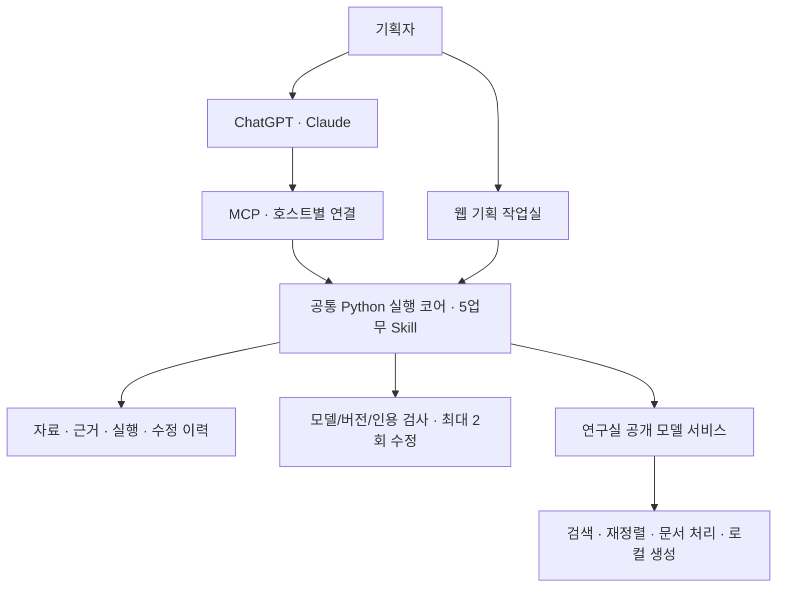

# 신청서 전체 구현을 위한 플러그인·웹·4인 협업 전략

검토일: 2026-10-04 KST. 이 문서는 초기 분석을 보존한다. 이후 사용자가 단일 레포·역할·2차 개발 초기 설정 계획을 승인했고 [개발 시작 안내](../docs/bootstrap/README.md)에 적용했다. 참가작 전체 구현은 미완료다.

## 판단

현재 Theme A 고객 불편·기존 제품 대조 기반 키친 상품기획 Agent를 유지한다. **공통 Python 분석 코어 + ChatGPT/Claude MCP 연결 + 웹 기획 작업실 + 공개 모델 기반 연구실 추론 서비스**를 권고한다. 현재 저장소를 단일 모노레포로 확장하는 것이 이번 제출까지 통합·재현 위험이 가장 낮다는 판단이다. 네 명은 독립 브랜치와 기능 묶음을 맡고 동시에 개발한다.

신청서 PDF 8쪽에 웹 UI의 요청 입력·근거 대조·콘셉트 비교·수정 이력을 명시했으므로, 신청 내용을 모두 반영하라는 최신 지시 아래 MCP만 제공하는 구성을 권고하지 않는다. 웹과 플러그인의 분석 로직·저장된 결과는 공유한다. 웹은 대량 자료·근거 교정·지속적인 프로젝트 관리에 집중한다.

10/20까지는 약 16일이다. 아래 기획 업무 구현은 **조건부로 가능한 중간~높은 난도**다. 실가전 제어·CAD·물리 시뮬레이터·모든 호스트의 동일한 고급 UI·대규모 학습까지 확대하면 제출 위험이 크게 증가한다. 구현 규모를 인위적으로 줄이는 대신 초기부터 데이터 계약과 전체 실행을 연결하고, 네 명의 독립 개발·평가를 병렬로 진행한다.

## 근거와 확인 범위

- 사용자가 제공한 실제 신청 PDF와 로컬 재신청본을 대조했다. 모두 1,370,129바이트·11쪽이며 SHA256은 `cca260fabbd8b7ed2a25550927b550edb90a8bc6f579ca9362112db3b100cd94`로 같다. 제안서는 PDF 2~9쪽이다. 개인정보가 있는 원본은 private/에 보관한다.
- 2차 공식 안내는 `자료/공식/05_2차과제_제출및평가안내.pdf` 2쪽. SHA256은 `c61fec7064674dbb4f4a6006a299c34c870ef2240b3a0f5d2e941c355777af24`이다. 원본 내용·페이지 렌더를 확인했다. 정확한 제출 시각·경로·용량·영상 길이는 이 PDF에 없으므로 미확정을 유지한다.
- 사용자 확인: 네 명 모두 고가 유료 AI 도구 사용, 연구실 RTX A6000 네 장 활용 가능. 서버 OS·드라이버·현재 점유·권한·외부 연결·실제 실행 성능은 확인 전이다.
- 공개 제품/API 문서는 아래 출처 목록을 10/4 확인했다. 계정별 기능·설치권한·학교망 접근은 실제 연결 시험 전이다.
- 1차 선정은 10/2 사용자 확인. 이번 사용자 보고의 전체 지원·탈락 수는 공식 명단 미대조이며 ‘28명/12팀/16팀’의 단위가 혼재한다. 수치를 합격률로 환산하거나 개별 심사 이유를 추정하지 않는다.

## 신청 내용의 전체 구현 대응표

아래는 의도한 업무 약속을 분해한 추적표다. 모두 아직 참가작 구현 완료로 확인되지 않았다. 페이지는 신청 PDF 기준이다. 이후 각 요구 ID를 Issue·코드·검증·시연에 연결한다.

| ID | 제출 약속·쪽 | 구현 완료를 확인할 방법 |
|---|---|---|
| R01 | 상품기획자의 반복 업무, 특정 가전 고정 답안이 아님·2~3 | 서로 다른 요청과 변경 조건에서 계획→조회→대조→생성→검사→수정이 실제 수행된다 |
| R02 | 제품군·고객·사용 상황·개선 과제·제외 조건·2,4 | 공통 요청 스키마를 검증하고 누락 정보를 질문하며 변경 요청을 반영한다 |
| R03 | 리뷰 CSV·명세·설명서 등록·2,8 | 업로드·파싱·자료 검증·조회가 실제 작동한다 |
| R04 | 리뷰 원문·제품 ID·출처 연결·4 | 결과에서 사용한 리뷰를 원문·같은 제품으로 추적한다 |
| R05 | 문서 모델·버전·기능·조건·위치 연결·4 | 각 기능 판단에서 해당 모델·자료 버전·페이지/행/문단 근거를 조회한다 |
| R06 | 실제/합성 자료·자료집 버전 구분·4 | 자료 메타데이터와 출력의 근거 연결에 자료 성격과 버전이 유지된다 |
| R07 | 첫 가상 모델 3~5개·합성 리뷰 30~50개·2,4 | 정해진 초기 자료집과 재실행 입력을 제공하며 분석 결과를 하드코딩하지 않는다 |
| R08 | 냉장고 첫 시연·제품군 교체 가능·2 | 냉장고 완주 후 식기세척기·전자레인지도 같은 도구 계약으로 실행한다 |
| R09 | 조사 계획·불편 묶기·기능 대조·기회 후보·근거/중복 검사·2 | 계획, 도구 호출과 입출력, 단계별 결과가 실행 기록에 남는다 |
| R10 | 동일 제품 자료 대조·누락 질문·4 | 다른 모델 자료 혼입을 검출·차단하고 부족한 조건을 요청한다 |
| R11 | 문서의 미언급을 기능 부재로 단정하지 않음·4 | 지원·미지원·근거 부족 등의 구분을 보존한다 |
| R12 | 기능 존재와 불편 해결을 구분·3~4 | 기능이 있어도 남는 사용 불편·추가 확인 사항을 도출한다 |
| R13 | 원문 연결 불편 목록·2 | 주요 불편마다 유효한 리뷰 ID·근거 위치를 제공한다 |
| R14 | 기존 기능↔잔여 불편 대조표·2 | 문제·기능·조건·남은 불편·근거를 함께 비교한다 |
| R15 | 최대 3개 타당한 콘셉트·요구사항·2 | 0~3개 후보에 근거·차별점·요구사항을 연결한다 |
| R16 | 근거 부족 시 보류·2 | 억지 후보 대신 이유·추가 질문·필요 자료를 반환한다 |
| R17 | 확인할 가정·실행 및 수정 기록·2 | 미확인 항목·수정 전후·실행 식별자를 보존한다 |
| R18 | 중복/근거 누락 시 해당 단계로 돌아가 수정·4,7 | 실제 오류 입력에서 검사 실패와 관련 단계 재실행이 발생한다 |
| R19 | 최대 2회 수정 후 미해결 이유·8 | 수정 상한과 성공·보류·미해결 종료 상태를 코드로 보장한다 |
| R20 | 원문의 지시문을 명령으로 사용하지 않음·8 | 문서의 악의적 지시를 자료로 취급하고 도구 권한을 확대하지 않는다 |
| R21 | 기획자 확인·추가 조건 입력·4 | 원문·판단을 확인하고 추가 조건으로 새 결과를 만든다 |
| R22 | 새 자료·명세 변경 후 재검토·4,7,9 | 영향을 받는 판단과 후보를 식별하고 근거·버전과 함께 수정한다 |
| R23 | 자료조회·니즈구조화·기능대조·콘셉트작성·검토수정의 5업무 Skill·7 | 각 업무의 SKILL.md·실행 코드·계약·예시를 제공하고 반복 실행한다 |
| R24 | Python 실행기·구조화 LLM·자료 저장소·교체 가능한 어댑터·8 | 실제 모델 호출·구조화 결과·실행 README와 어댑터 교체 검증이 있다 |
| R25 | 웹 요청 입력·근거 대조·콘셉트 비교·수정 이력·8 | 네 영역이 실제 서버 데이터와 연결되어 작동한다 |
| R26 | 샘플에도 실행 시점 생성·검사·8 | 입력·명세 변경에 따라 실제 생성/검사 결과가 바뀐다 |
| R27 | 기획 회의 자료로 내보내기·8 | 대조표·콘셉트·요구사항·근거·가정을 JSON/문서로 내보낸다 |
| R28 | 실행 Agent/Skill·데이터 사전·평가 사례·기록·제안서·9 | 제출 ZIP과 발표물에 산출물 및 재현 방법이 연결된다 |
| E01 | 개발 예시와 분리한 정상·중복·모델혼동·상충리뷰·근거누락·명세변경·7~8 | 6유형의 독립 사례를 실행하고 예상 대응과 실제 결과를 대조한다 |
| E02 | 강한 단일 프롬프트 비교·가린 결과 검토·7~8 | 같은 모델·자료·요청으로 비교하고 방식 이름을 가린 결과를 동일 기준표로 검토한다 |
| E03 | 인용 정확성·모델 오류·기능 중복·수정 시간·지연·호출 비용·7~8 | 측정 조건과 실제 기록을 제공하고 미측정을 성능 개선으로 쓰지 않는다 |

### 세 제품 예시의 완료 목표

| 예시·쪽 | Agent가 실제로 할 일 | 생성할 기획 결과 |
|---|---|---|
| 냉장고·5 | 청소 리뷰와 분리 선반 기능을 대조, 식품 전체 이동의 잔여 불편을 확인, 중복/근거 검사 | 구획별 탈착 트레이 등 조건에 맞는 제품 콘셉트, 용량·탈착 편의·세척성 요구사항·가정 |
| 식기세척기·6 | 기본 적재 안내와 실제 식기 조합 불편을 대조, 사용자 조건을 반영해 서비스 기회 도출 | 조합별 안내 서비스 콘셉트, 종류/크기 입력·적재 순서·간섭 확인 등의 기능 요구사항과 사용 흐름 |
| 전자레인지·7 | 이미 있는 설정 저장/호출 기능과 후보를 대조해 중복 제외, 인지/등록/호출 과정 질문, 새 근거 재분석 | 중복 제거 기록, 잔여 불편 또는 보류, 추가 질문·수정 결과 |

세 사례는 입력과 검증 사례를 마련해 실제로 실행한다. 모든 실행에서 위 예시와 같은 콘셉트가 나와야 하는 것은 아니다. **입력 근거가 달라지면 결과가 바뀌어야 한다.** 식기세척기 적재 최적화·물리 충돌 계산은 생성할 서비스의 요구사항이며 해당 소비자 서비스 자체 구현 약속으로 읽지 않는다. 냉장고도 제조 가능한 CAD 자동화가 아니다.

공개 제조사 문서 확대, 국내 기획자 인터뷰, 내부 자료 도입·권한 정책, 수요·제조 가능성 검증은 원안의 확장/검토 사항으로 관리한다. 현재 구현 완료와 미래 도입을 구분한다. 가능하면 짧은 실제 기획 업무 인터뷰나 공개 실제 문서 사례로 고객 문제를 보완하되 합성 실행 검증을 실제 시장 효과로 바꾸지 않는다.

## 심사기준에 대한 적합성

| 공식 2차 항목 | 점수 | 이번 구성의 적합 이유 | 필요한 증거·주요 위험 |
|---|---:|---|---|
| 고객 문제·구현 결과 | 20 | 상품기획자의 리뷰·제품 대조 반복 업무를 직접 지원 | 실제 필요한 업무인지와 결과 사용성을 보여줘야 한다. 도구 설명만으로 고객 문제 증거가 되지 않는다 |
| AI Agent 구조 | 20 | 사용자 요청→판단→5업무 Skill·Tool→검사/수정/보류 | 호스트 LLM·서버·사용자 역할, 도구 순서·권한·종료 조건을 명확히 한다. MCP 연결만으로 Agent 구현 인정은 보장되지 않는다 |
| 실제 작동·시연 | 10 | 채팅 요청·웹에서 같은 업무 결과와 변경 재실행 | 사전 정답 화면 대신 실시간 호출과 결과·오류 대응, 촬영 코드 일치를 보여준다 |
| 핵심 기능·Skill | 30 | 근거 조회·대조·중복 제외·수정·상태 저장을 재실행 | SKILL.md와 실제 실행 폴더·전체 코드·README, 독립 입력에 대한 동작 |
| 기대효과·확장 | 20 | 호스트 교체·제품군 교체·웹/채팅 재사용 | 비교 실측, 현재 한계, 확장 사례. 모델/GPU 개수 자체는 효과 증거가 아니다 |

호스트 LLM의 판단과 자체 도구를 결합한 Agent는 안내와 충돌하지 않는다는 **설계 해석**이다. 주최 측이 MCP 구성을 사전 승인했다는 의미는 아니다. 2차 안내 2쪽은 화면의 화려함·기능 개수보다 핵심 기능의 실제 작동을 중점 평가한다. 추가 기능은 R01~R28·E01~E03 완료를 지원하는 순서로 개발한다.

## 플러그인이 필요한 이유와 실행 구조

기획자는 익숙한 ChatGPT/Claude에서 업무를 시작한다. 우리 제품은 제품·자료 버전별 근거, 원문 위치, 구조화된 판단, 검사·수정과 변경 이력을 제공한다. 좋은 LLM을 교체하려는 것이 아니라 **그 LLM이 반복 가능한 상품기획 도구와 기록을 사용하도록 하는 것**이다.

예: “냉장고 청소 불편을 분석해줘” → 제품/자료집 선택 → Agent 조사 계획 → 관련 리뷰/기능 조회 → 잔여 불편 대조 → 후보 생성 → 인용·모델·중복 검사 → 저장. 이후 “새 설명서를 추가했어” → 영향 받은 판단 재검토 → 중복 후보 제외/수정 → 이력 비교. 채팅에서 선택한 실행을 웹에서 이어 볼 수 있다.



공통 코어는 계획 상태·입출력·자료 참조·검사·수정 상한·저장·내보내기를 보장한다. 채팅 경로에서는 호스트 LLM이 다음 도구와 구조화된 후보를 작성할 수 있고 서버가 검사한다. 웹 독립 실행은 동일 계약의 로컬/외부 LLM 어댑터를 사용한다. 모든 단계에서 두 LLM을 중복 호출하는 구조를 기본으로 만들지 않는다. 의미 판단과 규칙 검사 역할을 나누고 실행 모드·모델을 기록한다.

도구는 자료 등록/검색·작업 실행·단계별 결과·검토/수정·이력 조회로 나눈다. 사용자와 심사자는 단계 요약·도구명·근거·검사 결과를 확인한다. 숨겨진 모델 사고 과정의 공개를 구현 요건으로 가정하지 않는다.

LLM도 자료를 직접 읽을 수 있다. 우리 가치가 성립하려면 같은 자료의 강한 직접 프롬프트보다 모델 혼입·중복 제안·인용 오류·변경 후 수정 부담이 줄거나 자료 관리/재현이 좋아지는지 측정해야 한다. 비교 결과가 비슷하거나 불리하면 그 한계를 보고하고 개선한다.

## 웹 기능 우선순위

| 순서 | 기능 | 채팅 연결과 함께 제공할 이유 |
|---|---|---|
| 필수 | 요청 입력·근거 대조·콘셉트 비교·수정 이력·기본 내보내기 | 신청서에 명시된 결과를 저장·검토하고 실제 업무에 활용 |
| 추가 1 | 여러 CSV/PDF 일괄 등록·모델/버전 연결·진행률·오류 재시도 | 많은 자료를 다루는 업무, 공개 모델/GPU 활용과 직접 연결 |
| 추가 2 | 원문 페이지/행 옆 판단 표시·근거 교정·승인/보류 | 잘못 연결된 자료를 기획자가 확인하고 수정 |
| 추가 3 | 명세 v1→v2 영향 표시·변경 전후 비교 | 새 자료를 반영한 반복 기획과 신청서 수정 약속 강화 |
| 추가 4 | 팀 검토 의견·승인 상태·기획 보고서 내보내기 | 팀 회의·업무 전달에 활용, 근거와 확인할 가정 보존 |
| 후속 | 정기 수집·폭넓은 제품 비교·고급 동시편집·콘셉트 이미지 | 추가 가치는 있으나 완주·검증 뒤 순위 조정 |

ChatGPT MCP Apps와 Claude의 interactive connectors는 채팅 안의 카드·표·상호작용 UI를 지원한다. 따라서 웹을 만드는 이유는 채팅에서 그림을 못 보여서가 아니라 **큰 자료집·원문 교정·여러 후보 비교·지속적인 상태 관리**다. 호스트별 UI 차이를 실제 시험하고 동일 핵심 도구를 먼저 보장한다. UI 코드는 가능한 공통화하되 설치/인증 어댑터는 호스트별로 관리한다.

## 공개 모델·오픈소스 및 A6000 활용

아래는 공식 모델 카드/저장소를 확인한 배포 후보다. 아직 연구실 서버 실행과 한국어 가전 문서 성능을 검증한 모델 채택이 아니다. 코드 라이선스와 모델 가중치 라이선스는 각각 기록한다.

| 역할 | 후보 | 확인 사항 | 적용 판단 |
|---|---|---|---|
| 의미 검색 | BAAI/bge-m3 + FlagEmbedding | MIT·다국어·1024차원·8192토큰 | BM25와 함께 한국어 리뷰/기능 문단 검색 비교 |
| 재정렬 | BAAI/bge-reranker-v2-m3 | Apache-2.0·다국어·약 0.6B | 상위 검색 문단 재정렬. 점수를 문제 해결 확률로 쓰지 않는다 |
| 한국어 OCR | PaddleOCR·korean_PP-OCRv5_mobile_rec·PP-OCRv5_mobile_det | 카드/코드 Apache-2.0 | 스캔 자료의 검출→인식→페이지/좌표 저장. 텍스트 PDF는 텍스트 추출 우선 |
| PDF 구조 | Docling | 코드 MIT·내부 모델 개별 확인 | 표/읽기 순서 보존. 실제 표본으로 단순 파서/OCR와 비교 후 필요한 경로 사용 |
| 로컬 구조화·웹 생성 | Qwen/Qwen3-8B | Apache-2.0·8.2B·BF16 | 리뷰 구조화·웹 배치 실행. 한국어·JSON·인용 시험 후 활성화 |
| 모델 서빙 | vLLM / Transformers | 환경·버전을 고정 | Linux·CUDA 호환 확인. 소형 검색 모델은 작은 Python 서비스로도 충분 |

GPU는 RTX A6000 기준 카드당 48GB다. 공식 NVLink 브리지는 두 장 연결을 지원하며 네 장이 자동으로 하나의 192GB 장치가 되지 않는다. 제안 배분:

- GPU 0: 로컬 LLM 리뷰 구조화·웹 생성/배치.
- GPU 1: 임베딩·재정렬·OCR 전처리, 배치별 자원 측정.
- GPU 2~3: 모델 후보·독립 평가·동시 개발 실험·추가 전처리.

Qwen3-8B BF16 가중치 계산은 약 16.4GB이며 캐시/작업 메모리는 추가된다. 단일 8K 문맥·낮은 동시성으로 20~30GB 계획치에서 시험한다. BGE 모델별 2~5GB는 작은 배치의 초기 예산일 뿐 실측이 아니다. 현재 vLLM 안내는 Linux 및 NVIDIA compute capability 7.5 이상을 요구하고 모델이 한 GPU에 들어가면 분산 실행이 대체로 필요하지 않다고 설명한다.

서버 활용 성과는 실제 처리량·응답시간·재실행·비용으로 보여준다. 네 장을 항상 점유하거나 초기부터 큰 모델 학습을 하는 것을 목표로 삼지 않는다. 필요 시 확인된 실패 유형의 평가/학습은 별도 실험 Issue로 진행한다. models.lock에는 모델 ID·revision·라이선스·서빙 버전·실행 설정을 고정하고 제출 README에 다운로드·대체 CPU/외부 어댑터 경로를 설명한다. 공식 재실행 자원·대형 모델 파일 제출 방식은 컨설팅에서 확인한다.

## ChatGPT·Claude와 ‘12/11 커스텀 GPT 종료’ 확인

10/4 OpenAI 공식 `Moving your custom GPT workflows to plugins`를 확인했다. **Enterprise 관리자·GPT 제작자 대상 전환 안내**이며 커스텀 GPT를 플러그인으로 옮기는 방향을 명시한다. custom actions는 자동 이전되지 않고 connector/MCP로 다시 연결·시험해야 한다. 다른 플랜의 일정/공유 조건이 다를 수 있다고 문서에 적혀 있다.

그러나 확인한 안내에 12/11이라는 날짜는 없었다. 모든 개인 유료 계정의 커스텀 GPT가 그날 종료된다고 확정하지 않는다. OpenAI API deprecations에는 일부 구형 GPT-5/o3 스냅샷의 2026-12-11 종료가 별도로 표시되어 있으며 이는 커스텀 GPT 제품 종료와 다른 항목이다. 사용자가 본 공지의 정확한 적용 서비스·플랜·날짜는 추가 확인 사항이다.

플러그인 우선 방향은 이 날짜가 확정되지 않아도 적절하다. 모델/호스트와 도구 코어를 분리하면 클라이언트 교체에 대응할 수 있다. ChatGPT 공식 quickstart는 developer mode에서 MCP 연결을 시험하도록 안내하며, Claude도 remote MCP·interactive connectors를 제공한다. 팀 실제 계정에서 설치·tool 호출·UI·인증을 각각 시험해야 한다.

공식 공개 디렉터리 배포는 검증·권한·심사·안정된 HTTPS endpoint 등 별도 요건이 있다. 해커톤 구현/시연은 개발 연결로 준비하고, 공개 디렉터리 심사를 10/20 완료의 필수 의존으로 만들지 않는다. 연구실 내부망에 있는 서비스를 외부 호스트가 호출할 수 있는지 초기에 시험하고 HTTPS gateway/인증·터널 등 실제 가능한 경로를 정한다. GPU 서버를 전부 공개할 필요는 없다.

고가 채팅 구독은 그 계정의 실제 연결 권한·API 크레딧·호출 한도·서버 접근을 모두 보장한다는 뜻이 아니다. 개발에 사용하는 AI와 완성 제품의 실행 모델·요금 경로를 분리해 확인한다.

## 레포 구조 및 네 명의 지속적인 병렬 작업

### 기본 권고: 한 레포, 독립 배포 가능한 패키지

```text
lg-ax-2026/
  apps/web/                 웹 기획 작업실
  apps/mcp/                 MCP 서버·호스트 연결·채팅 UI
  packages/core/            공통 Python 실행/분석/검사/상태
  packages/contracts/       요청·근거·판단·콘셉트·오류 스키마
  services/inference/       공개 모델 실행·health·설정
  skills/                  5업무 SKILL.md·scripts·examples
  evals/                   독립 사례·기준선·측정 결과
  tests/                   계약·개별·통합 검증·fixtures
  docs/requirements/       R01~R28/E01~E03→구현→증빙
  harness/phase2/           개발·통합·평가·제출 패킷/상태
  scripts/                 실행·검사·평가·제출 ZIP
  .github/                 Issue/PR 양식·CI
  private/                 개인정보·접수증빙(기존 Git 제외)
```

Python core와 TypeScript web은 JSON Schema/OpenAPI 계약으로 연결한다. 제품 규칙·분석은 web과 mcp에서 중복 구현하지 않는다. 구조는 제안이며 아직 생성하지 않았다.

| 비교 | 모노레포 | 웹/core+MCP/통합 3개 |
|---|---|---|
| 네 명의 독립 개발 | 각자 clone·branch·필요시 worktree | 가능 |
| 공통 규격 변경 | 같은 PR에 변경과 소비자 검사 | 여러 PR·호환 버전 조정 |
| 독립 서비스 배포 | 가능 | 가능 |
| 제출 ZIP | 한 코드 commit으로 연결 | 모든 repo commit·모델·계약 버전 봉인 필요 |
| 주요 위험 | 공유 파일 편집 충돌 | 규격·릴리스 불일치, 통합 담당 의존 |
| 현재 판단 | 제출 일정에 더 적합 | API/패키지 경계가 안정된 뒤 재검토 |

세 개도 가능하지만 사용자 구상에는 공통 분석 코어·추론 서비스의 소유 위치가 빠져 있다. 선택한다면 plugin repo를 core+MCP로 명확히 하고 웹도 그 서비스를 사용한다. 현재 repo는 규격 원본·통합평가·release manifest·제출을 담당한다. 최신 main을 자동 조합하지 않고 정확한 각 SHA/tag와 계약 버전을 고정해야 한다.

### 분담은 화면/서버 한 조각보다 업무 묶음

이름별 최종 배정은 미정이다. 각 스트림은 자신의 UI·도구·코드·검증까지 소유한다.

| 스트림 | 독립 개발 범위 | 의존 작업이 준비되지 않았을 때 계속할 일 |
|---|---|---|
| 1 자료·근거 | 등록·파싱·OCR·모델/버전·검색/재정렬·원문 탐색 UI·관련 도구 | 문서 유형 확대·실패 입력·인용 정답 세트·검색 비교 |
| 2 불편·기능 대조 | 리뷰 구조화·제품별 대조·잔여 불편·상충 자료·대조 UI·검사 | 계약 fixtures로 UI/검사 개발·오류 사례·강한 baseline |
| 3 콘셉트·변경 | 최대 3후보/보류·요구사항·중복 제외·변경 영향·이력 UI·관련 도구 | 후보/변경 fixtures·비교 검사·재실행·보고서 출력 |
| 4 실행·클라이언트·재현 | MCP/호스트 연결·웹 workspace 조합·모델 실행·전체 flow·ZIP·시연 | 계정 연결 실험·실행 환경·계약 검사·평가 runner·README 재현 |

④가 모든 병합·배포를 독점하는 병목이 되지 않게 각자 해당 서비스 실행·검증을 담당하고 공통 CI로 통합한다. 다른 스트림의 완성을 기다리는 대신 고정 계약의 mock을 사용해 개발한다. mock 검증과 실제 모델/서버 실행은 분리하고 최종 검증에서는 실제 경로를 사용한다. 각자 Ready 업무 목록에서 기능·회귀검사·실험·성능·사용성 작업을 이어간다. 하루 단위로 전체 흐름을 합치고 긴 브랜치를 제출 직전에 통합하지 않는다.

### GitHub Projects·Issue 양식

Projects 한 개는 여러 repo의 Issue/PR를 모을 수 있다. 단일 repo에도 동일 방식으로 쓸 수 있다. 필드 권고: 담당자·업무 영역·공식 요구 ID·우선순위·상태·목표일·의존 Issue·실행 증빙. 상태: Ready→Doing→개별 검증→통합 검증→Done.

양식은 기능 구현, 규격 변경, 통합 오류, 모델/비교 실험, 제출 산출물로 나눈다. 각 Issue에는 사용자 작업·요구 ID·입출력·완료 사례·편집 범위·재실행 증빙을 담는다. PR은 연결 Issue·계약 영향·검증·실제 시연을 설명한다. 공통 계약의 최신 원본은 versioned 파일이며 Issue 댓글만으로 규격을 정의하지 않는다.

## 하네스·AGENTS.md·CLAUDE.md 재검토

현재 `harness.py status`는 선택 A와 1차 문서 done, 구현·평가·발표 pending을 보여준다. 반면 `atoz.json`의 목표와 next 패킷은 아직 구현 난도/서류 설득력의 후보 탐색 brief다. `ax_workflow.py validate`는 brief/design/ideate/probe/proposal/research/screen/select/submission의 artifact/dependency stale로 실패한다. 최신 요건/접수 기록과 당시 해시가 달라진 영향이며, 실제 참가작이 완성돼 실패한 뜻은 아니다. 기존 CI가 이 검사에 의존하므로 구현 시작 전 해결해야 한다.

**선정·신청 기록을 보존한 phase1 archive와 2차 active 실행을 분리하는 이행**을 권고한다. 채택 아이디어를 다시 고르거나 해시만 새로 덮어 과거 검토를 완료로 꾸미지 않는다. 이번 분석에서는 기존 atoz 파일을 변경하지 않았다.

2차 흐름: 신청서 요구 추적→계약·구현 설계→4스트림 개발→전체 실제 실행→독립 비교 평가→발표/영상/ZIP 검수→제출 증빙.

새 상태에는 요구별 예정/구현/개별 검증/통합 검증, source hash·code commit·모델 revision·자료집 버전, 실패 이유·측정·다음 Ready Issue를 기록한다. 일반 코드/fixture CI와 GPU 실모델 평가를 나누고 최종 gate에는 다음을 포함한다.

- 세 제품 사례와 조건 변경, 보류/상충 자료/모델 혼동/근거 누락/명세 변경/문서 지시문 처리.
- 웹↔MCP 동일 프로젝트·자료·결과·수정 이력 연결.
- 5업무 Skill 재실행, 수정 상한, 원문 연결·구조화 검사.
- 강한 프롬프트 baseline·독립 평가·토큰/지연/비용 기록.
- 깨끗한 환경의 README/소스 ZIP 실행과 촬영 코드 commit 일치.

최신 직접 사용자 지시로 root AGENTS.md와 CLAUDE.md는 동일한 전체 내용을 유지한다. 참조만 하는 축약본 권고는 폐기했다. AGENTS.md를 관리 원본으로 두고 scripts/sync_agent_rules.py가 복사·바이트 일치 검사를 수행한다. 패키지별 AGENTS.md/CLAUDE.md는 공통 규칙을 지키며 지역 실행법을 추가한다. 세 repo를 택할 경우 규칙 kit·contracts를 고정 버전으로 공급하고 CI가 차이를 검사한다. 다른 repo URL만 적어 놓는 것은 자동 동기화가 아니다.

개발을 돕는 수행 하네스와 심사받을 상품기획 Agent/Skill은 별개의 시스템이다. 하네스 점검 통과를 고객 문제·모델 성능·Agent 완성으로 표현하지 않는다. 이번에 분석 기록과 project 리뷰 상태만 갱신하며 새 실행 하네스 구축은 구조 결정 후다.

## 제출 일정과 객관적 검증

아래는 제안 일정이며 공식 새 공지가 아니다. 네 명의 기능 개발·평가는 전체 기간 동시에 진행한다.

| 목표 구간 | 통합 gate |
|---|---|
| 10/4~6 | R/E 추적표·공통 계약·서버 접근·두 호스트 tool 연결·냉장고 얇은 전체 실행. 10/6 안내와 컨설팅에서 미확정 규격 확인 |
| 10/7~10 | 5업무 Skill·웹 4영역·실제 공개 모델 검색/처리·검사/수정/저장 연결 |
| 10/11~14 | 세 제품 사례·조건/문서 변경·보류·실패 대응, 추가 근거 검토/배치 기능 |
| 10/15~17 | 신청서 약속의 6유형 독립 평가·강한 baseline·가린 결과 검토·수정 시간/지연/비용/토큰 측정 |
| 10/18~19 | 코드/모델/자료 버전 고정·README 재실행·발표/영상/ZIP 생성·전수검수 |
| 10/20 | 공식 시각/경로 확인에 따라 제출·첨부본/증빙 확인 |

개별 정확도/합격확률을 임의 점수로 추정하지 않는다. 특히 의미적 기능 중복·잔여 불편의 판단은 규칙 검사만으로 해결되지 않아 가장 어려운 부분이다. 모델별 자료 ID·버전 연결, 호스트 인증/네트워크, 공통 상태, 독립 평가가 주요 위험이다. 첫 2~3일 연결 결과를 보고 일정과 추가 기능 순서를 조정한다. 필수 신청 기능을 누락한 상태로 ‘축소 MVP 완성’을 보고하지 않는다.

토큰 절감은 대량 원문 대신 관련 근거 전달, 문서/임베딩/결과 캐시, 코드로 가능한 검증의 모델 호출 감소로 시도한다. 캐시는 자료/요청/모델 버전을 키로 관리한다. 같은 입력·모델·작업에서 host 토큰·server 토큰·호출 수·지연·성공/오류를 함께 기록한다. 채팅이 실제 사용량을 제공하지 않으면 추정/직접 측정을 구분하고 통제 가능한 실행 어댑터에서 측정한다. 로컬 모델로 옮긴 것만으로 총 토큰이 줄었다고 주장하지 않는다.

## 1차 선정의 의미

1차 선정은 제출 아이디어로 구현을 진행할 근거다. 따라서 주제를 다시 만드는 대신 신청한 업무를 잘 구현하는 데 집중한다. 그러나 개별 평가 의견이 없는 현재 ‘심사자가 모든 구현 가능성을 보증했다’거나 ‘28개 중 12개 선정이니 수상 가능성이 몇 %’로 해석할 수 없다. 지원/탈락 수·단위·개별 심사 이유는 확인되지 않았다. 2차는 실제 실행·Skill·재현성과 평가 증거로 판단받는다.

## 확인한 외부 공식 출처

확인일은 모두 2026-10-04. 제품/요금제별 권한·서버 성능은 팀 계정/장비에서 실측 전이다.

- [OpenAI 커스텀 GPT→플러그인 전환(Enterprise 안내)](https://learn.chatgpt.com/docs/migrate-custom-gpts)
- [OpenAI 플러그인 quickstart](https://developers.openai.com/plugins/quickstart)
- [OpenAI MCP 서버·배포/개발 연결](https://developers.openai.com/plugins/build/mcp-server)
- [OpenAI 채팅 MCP Apps UI](https://developers.openai.com/plugins/build/chatgpt-ui)
- [OpenAI 공개 디렉터리 심사/개발 연결 구분](https://developers.openai.com/plugins/deploy/app-review)
- [OpenAI API deprecations](https://developers.openai.com/api/docs/deprecations)
- [Claude remote MCP custom connectors](https://support.claude.com/en/articles/11175166-get-started-with-custom-connectors-using-remote-mcp)
- [Claude interactive connectors/MCP Apps](https://support.claude.com/en/articles/13454812-use-interactive-connectors-in-claude)
- [BGE-M3 모델 카드](https://huggingface.co/BAAI/bge-m3) · [reranker 모델 카드](https://huggingface.co/BAAI/bge-reranker-v2-m3) · [FlagEmbedding](https://github.com/FlagOpen/FlagEmbedding)
- [PaddleOCR](https://github.com/PaddlePaddle/PaddleOCR) · [한국어 OCR 인식](https://huggingface.co/PaddlePaddle/korean_PP-OCRv5_mobile_rec) · [영역 검출](https://huggingface.co/PaddlePaddle/PP-OCRv5_mobile_det)
- [Docling](https://github.com/docling-project/docling) · [Qwen3-8B](https://huggingface.co/Qwen/Qwen3-8B)
- [NVIDIA RTX A6000](https://www.nvidia.com/en-us/products/workstations/rtx-a6000/)
- [vLLM GPU 환경](https://docs.vllm.ai/en/latest/getting_started/installation/gpu/) · [vLLM 분산 기준](https://docs.vllm.ai/en/latest/serving/parallelism_scaling/)
- [Git worktree](https://git-scm.com/docs/git-worktree) · [GitHub Projects](https://docs.github.com/en/issues/planning-and-tracking-with-projects/managing-items-in-your-project/adding-items-to-your-project) · [GitHub Issue forms](https://docs.github.com/en/communities/using-templates-to-encourage-useful-issues-and-pull-requests/configuring-issue-templates-for-your-repository)
