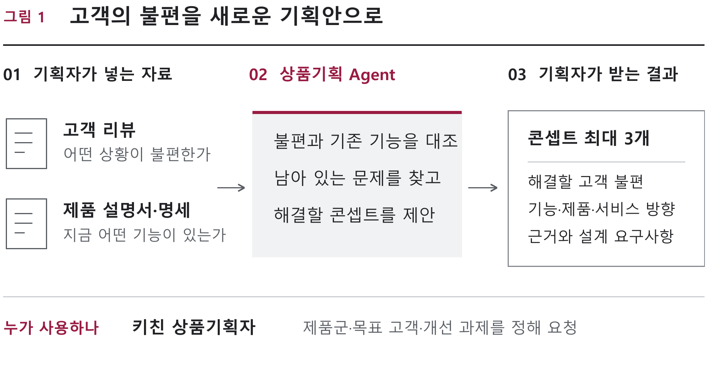
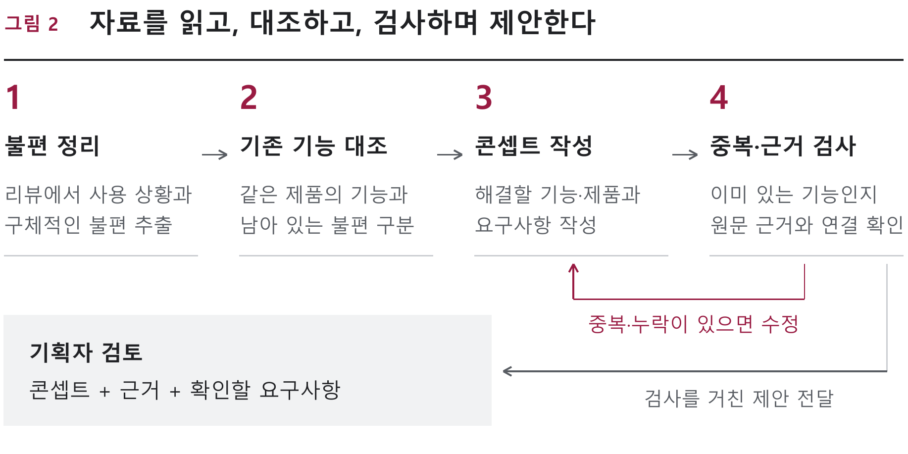
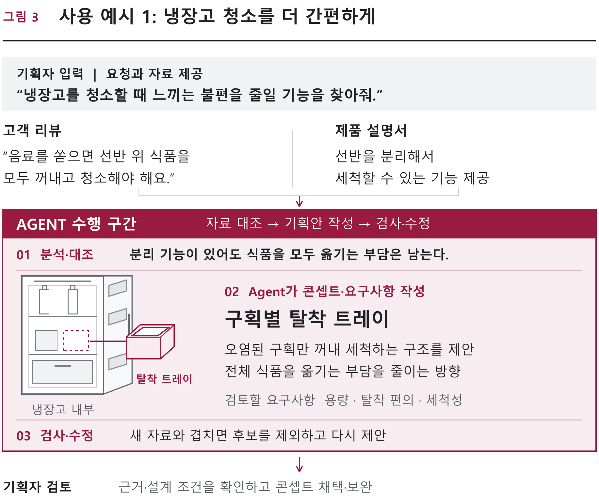
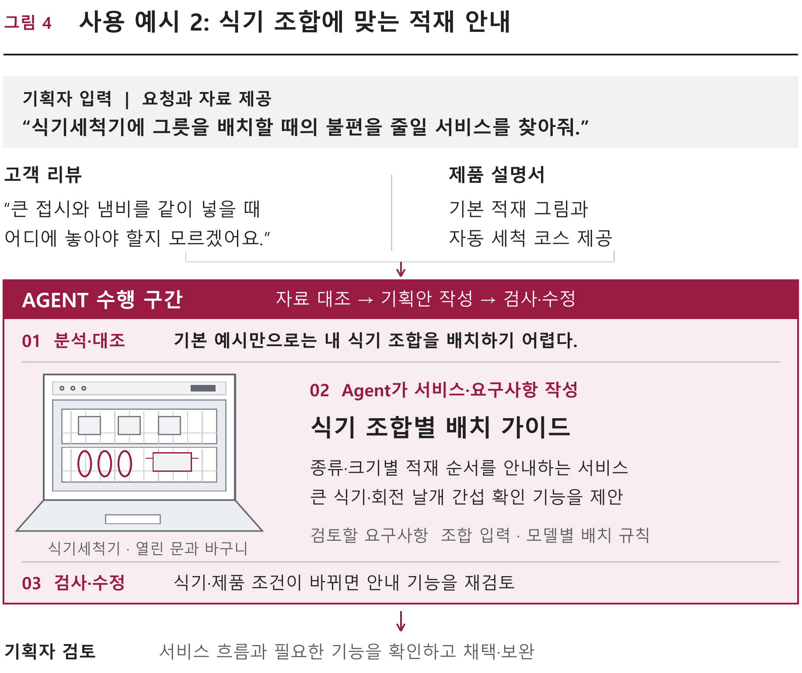
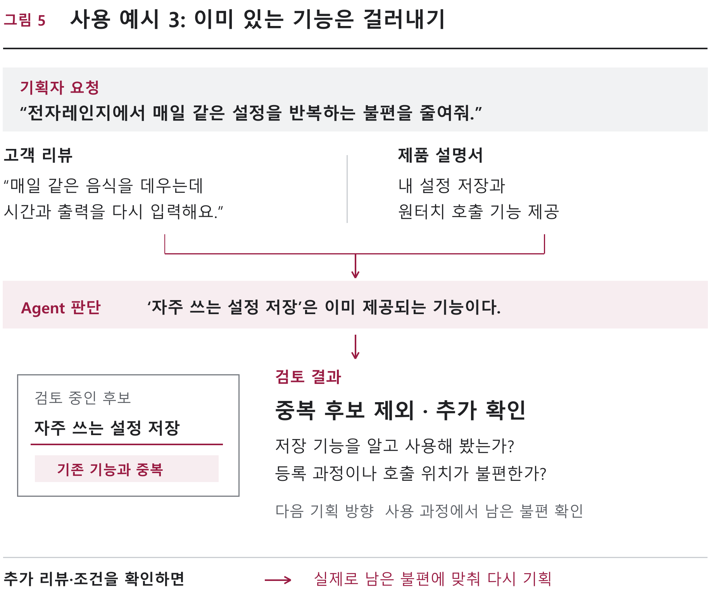

# 고객 불편·기존 제품 대조 기반 키친 상품기획 Agent

Theme A / 2026-09-27 사용자 채택 / 공식 양식용 원고

## 1. 아이디어 제안내용 개요

### 제안: 불편의 근거와 제품 기능을 연결하는 AI 상품기획 담당자
키친 상품기획자가 고객 리뷰와 제품 설명서를 함께 검토할 때, 무엇이 이미 해결된 문제이고 무엇이 여전히 남은 불편인지 구분하도록 돕는 Agent를 개발한다. 기획 요청과 자료를 입력하면 고객 불편을 구조화하고, 해당 모델의 기존 기능과 대조한 뒤, 근거가 연결된 신규 기능·제품·서비스 콘셉트와 요구사항을 작성한다.

### 입력 → 수행 → 산출물
입력은 대상 고객·제품군·기획 조건, 리뷰 CSV, 제품 명세·설명서다. Agent는 조사 계획 수립 → 관련 자료 조회 → 불편 묶기 → 모델별 기능 대조 → 기회 후보 생성 → 근거·중복 검사 → 수정 순서로 업무를 수행한다. 결과는 ① 원문이 연결된 불편 목록 ② 기존 기능과 잔여 불편의 대조표 ③ 타당한 콘셉트 최대 3개와 요구사항 ④ 확인이 필요한 가정 ⑤ 실행·수정 기록이다. 근거가 부족하면 후보를 억지로 만들지 않고 보류한다.

### 첫 구현과 시연 범위
하나의 키친 가전 제품군에서 가상 모델 3~5개와 합성 리뷰 30~50개로 전체 흐름을 구현한다. 첫 시연은 냉장고의 수납·정리·청소 상황으로 구성하되, 제품군은 교체 가능한 입력으로 설계한다. PC의 웹 화면에서 Agent의 실제 분석·조회·검사·수정을 보여준다. 실기기 제어나 제조용 설계도, 물리 시뮬레이션은 초기 구현의 필수 범위로 두지 않는다.

## 2. 제안배경

### 고객의 말에서 신규 기획으로 넘어가는 대조 업무
리뷰에 “선반 청소가 어렵다”는 표현이 있어도, 곧바로 “분리형 선반을 만들자”는 결론을 낼 수는 없다. 해당 모델에 이미 분리 기능이 있을 수 있고, 같은 불편 표현이 탈착 방법을 모르는 문제와 식품을 모두 꺼내야 하는 구조적 부담을 함께 가리킬 수 있기 때문이다. 상품기획에는 불편 요약 이후에 모델·기능·사용 조건을 연결하는 검토가 필요하다. 이 예시는 업무 설명을 위한 가상 사례다.

### 관련 업무의 활용 사례와 남은 검증 과제
주방가전 기업 Breville의 공개 사례는 고객 연구를 제품·디자인 의사결정에 활용하고 연구 자료를 조직 내에서 공유하는 업무를 소개한다.[1] Dovetail은 고객 데이터의 근거 조회와 반복 업무를 수행하는 AI Agent 기능을 이미 제공한다.[2] 따라서 단순 리뷰 요약이나 문서 생성 자체를 신규성으로 주장하지 않는다. 본 제안은 키친 제품의 모델별 기능 대조와 미해결 불편의 구분을 하나의 검토 흐름으로 묶는 데 초점을 둔다. 실제 국내 기획자의 사용 빈도와 도입 효과는 후속 인터뷰·과제 평가로 확인한다.

### Theme A와의 연결
고객 리뷰에서 니즈를 찾고, 기존 제품 정보를 비교해 기회를 발굴하며, 그 근거로 키친 기능·제품·서비스 콘셉트를 제안한다. 공식 Theme A의 AI 상품기획 역할을 반복 수행하는 구현물로 구체화한다.[3] 사용자가 원하는 것은 특정 가전의 고정 답안이 아니라, 기획 조건과 자료가 바뀌어도 다시 실행할 수 있는 업무 도구다.

## 3. 활용정보

### 기획 요청·고객 리뷰·제품 문서를 함께 활용
기획자가 제품군, 목표 고객, 사용 상황, 개선 과제와 제외 조건을 입력한다. 고객 리뷰에는 원문·제품 식별자·출처를, 제품 문서에는 모델·버전·기능·사용 조건·근거 위치를 연결한다. Agent는 동일 제품의 자료를 찾아 불편과 기존 기능을 비교한다. 누락된 조건은 질문하고, 설명서에 언급이 없다는 이유만으로 기능이 없다고 단정하지 않는다.

### 자료가 바뀌어도 다시 수행하는 업무 흐름
리뷰에서 고객 상황과 불편을 추출하고 제품 문서와 대조해 콘셉트를 작성한다. 차별점 없이 기존 기능을 재제안했거나 근거가 누락되면 해당 단계로 돌아가 수정한다. 기능이 존재해도 사용 불편은 남을 수 있으므로 구분해서 검토한다. 기획자는 원문과 판단을 확인하며 추가 조건을 입력할 수 있다.

### 초기 자료 구성과 관리
가상 모델 3~5개와 합성 리뷰 30~50개를 먼저 준비하고, 이후 공개 제조사 자료로 확장한다. 실제 자료와 합성 자료의 구분, 자료집 버전, 원문 위치를 저장한다. 합성 샘플의 빈도를 시장 수요 비율로 해석하지 않으며, 실자료를 추가할 때 사용 권한과 개인정보 포함 여부를 확인한다.

### 활용한 참고자료 (확인일: 2026-09-27)
[1] Dovetail, Breville 고객 연구의 제품 기획 활용 사례. https://dovetail.com/customers/breville/
[2] Dovetail, AI Agents. 근거 추적·반복 업무 기능의 비교 자료. https://dovetail.com/product/ai-agents/
[3] 국립창원대학교, AX 해커톤 모집공고·참가신청서 및 LG 키친솔루션 주제 자료(19~20, 29~31쪽). https://anchor.changwon.ac.kr/main/menu?gc=Program&do=sinform&spod=s1&program_id=VUlvrXMnryLR&psin_id=VUlvrXN53VEd

## 4. 제안 아이디어 설명 및 차별성

### 사용 예시 1. 냉장고: 제품 구조 개선
리뷰의 불편과 제품 기능을 함께 읽어 해결되지 않은 문제를 찾고, 이를 콘셉트와 설계 요구사항으로 구체화한다. 냉장고 청소 사례에서는 ‘선반을 분리할 수 있음’과 ‘식품을 모두 옮겨야 함’을 구분해 구획별 탈착 트레이를 제안한다.

### 상품기획자가 받는 결과
기존 기능과 남은 불편의 대조표, 콘셉트의 동작 방식, 요구사항과 확인할 가정을 받는다. 트레이의 수납 용량·탈착 편의·세척성처럼 후속 설계에서 확인할 항목을 함께 정리한다.

<!-- pagebreak -->

### 사용 예시 2. 식기세척기: 안내 서비스 기획
같은 Agent로 제품 구조뿐 아니라 서비스 콘셉트도 검토한다. 식기세척기의 기본 적재 그림과 고객이 실제로 가진 식기 조합 사이의 차이를 찾아, 조합별 배치를 돕는 안내 서비스와 요구사항을 제안한다.

### 상품기획자가 받는 결과
식기 종류·크기 입력, 적재 순서 안내, 큰 식기와 회전 날개 간섭 확인 등 서비스 기능의 후보와 고객 사용 흐름을 받는다. 대상 모델과 식기 조건이 바뀌면 필요한 안내 기능도 다시 검토한다.

<!-- pagebreak -->

### 사용 예시 3. 전자레인지: 기존 기능 중복 걸러내기
리뷰의 불편을 그대로 신규 기능으로 바꾸지 않는다. 해당 모델에 설정 저장과 호출 기능이 이미 있다면, 차별점 없이 같은 기능을 재제안한 후보를 제외한다. 고객의 불편까지 해결됐다고 판단하지 않고, 기능 인지·등록·호출 과정에서 어려운 지점을 확인할 질문을 기획자에게 돌려준다.

### 다섯 가지 업무를 반복 수행하는 Agent
자료 조회·니즈 구조화·기능 대조·콘셉트 작성·검토 및 수정을 각각 Skill로 구성한다. 모든 주요 판단에 원문과 제품 모델을 연결하고, 인용 누락·모델 혼동·기능 중복이 있으면 다시 작성한다. 위 세 사례는 같은 Agent의 활용 범위를 보여주며, 최초 구현은 냉장고 자료부터 시작한다.

### 일반 LLM·기존 도구 대비 확인할 가치
일반 LLM도 좋은 프롬프트와 자료로 유사한 분석을 할 수 있다. 본 Agent는 자료·모델 ID 연결, 판단 검사, 변경 후 재검토를 반복 가능한 절차로 만든다. 동일 자료를 제공한 강한 단일 프롬프트와 비교해 오류와 사람의 수정 부담이 줄어드는지 평가한다. 기존 도구에 대한 우월성을 미리 단정하지 않는다.

## 5. 추진방향

### 구현 구조와 반복 실행
Python 실행기, 구조화 출력을 지원하는 LLM 1개, CSV·문서 저장소, 웹 UI로 구성한다. LLM은 계획·의미 해석·기획·재검토를, 코드는 자료 조회·ID 확인·필수 항목 검사·저장을 맡는다. 모델 API는 선발 후 호출·비용·응답 형식을 확인하고 교체 가능한 어댑터로 연결한다.

검사 실패 시 최대 2회 수정하고 미해결 항목·이유를 남긴다. 원문의 지시문은 실행 명령으로 사용하지 않는다. 웹 UI는 요청 입력·근거 대조·콘셉트 비교·수정 이력으로 구성한다. 준비된 샘플을 쓰더라도 생성·검사는 실행 시점에 실제로 수행한다.

### 일정과 3인 협업 계획
팀장 정이량을 포함한 3인이 Agent·도구, 데이터·평가, UI·문서를 나눠 개발하고 교차 검토한다. 개인별 역할은 착수 시 확정한다. 10/20 결과물 제출과 10/28 본선에 맞춰 20쪽 이내 발표자료·5분 시연을 준비한다.[3]

10/2~5 입력 자료와 첫 실행을 준비하고, 10/6~8 컨설팅으로 실무 적합성을 점검한다. 10/9~13 검사·수정 루프와 웹 UI를 완성한 뒤, 10/14~17 오류를 개선하고, 10/18~20 실행물·문서·시연을 정리한다.

### 검증 설계
정상 입력·기능 중복·모델 혼동·상충 리뷰·근거 누락·명세 변경 사례를 개발 예시와 분리한다. 검토자는 방식 이름을 가린 결과를 같은 기준표로 평가한다. 평가는 예정 사항이며 측정 완료 수치를 제시하지 않는다.

인용의 정확성, 모델 연결 오류, 기존 기능과의 중복, 기획자가 수정하는 데 걸린 시간을 같은 조건에서 기록한다. 실행 지연과 호출 비용도 함께 확인해 품질과 사용 부담을 비교한다.

### 실제 업무로 연결하는 도입 방향
초기에는 한 제품군의 기획 과제를 대상으로 자료 업로드부터 콘셉트 검토까지 시범 적용한다. 기획자가 확인한 대조표와 요구사항을 기획 회의 자료로 내보내고, 피드백을 반영해 공개 제품 문서와 다른 키친 제품군으로 확장한다. 반복 대조·재검토 시간을 줄이는 업무 보조 도구로 활용하며, 기업 내부 자료를 연결할 때는 접근권한과 보관 정책을 별도로 적용한다.

## 6. 기대효과

### 기획 검토 시간을 어디에 쓰는지 바꾼다
원문과 제품 기능을 오가며 대조하는 작업을 정리해, 기획자가 잔여 불편의 타당성과 콘셉트 선택에 집중하도록 돕는다. 모든 주요 판단에 원문·모델·불확실성을 연결해 팀원이 결과를 확인하고 수정하기 쉽게 한다. 시간 절감률이나 정확도 향상률은 구현·평가 후 확인할 지표로 남긴다.

### 재사용 가능한 상품기획 절차
냉장고 시연 이후 다른 키친 제품군의 리뷰와 명세를 넣어 같은 입력 계약·조회·대조·검토 절차를 재사용한다. 제품군마다 새로운 기능 용어와 제약을 추가 검증해야 하며, 한 사례의 성공을 모든 가전으로 일반화하지 않는다. 반복 실행 가능한 Agent/Skill, 데이터 사전, 평가 사례, 실행 기록, 근거 기반 콘셉트 제안서를 결과물로 남긴다.

### 성공 판단과 적용 한계
첫 목표는 ‘불편 입력 → 제품 기능 대조 → 후보 생성 → 변경 조건 반영 → 근거와 함께 수정’ 흐름이 다른 입력에서도 작동하는 것이다. 합성 데이터 실험은 논리와 오류 처리 검증에 사용하고, 시장 수요·물리 성능·제조 가능성은 실자료 조사와 분야 전문가 검토 과제로 구분한다. 검토가 필요한 항목을 숨기지 않는 상품기획 보조 도구를 목표로 한다.
