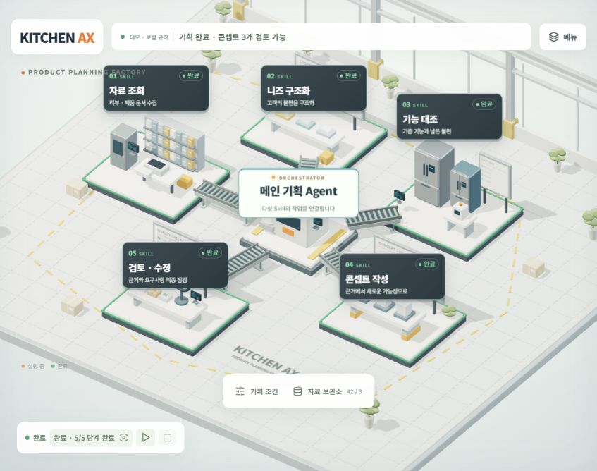
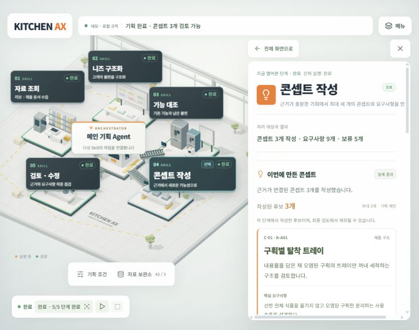

# 대시보드 신진하

KITCHEN AX 상품기획 대시보드의 독립 폴더 백업입니다. 현재는 실제 입력을 처리하는 로컬 규칙 데모이며, 실제 LLM 의미 분석과 독립 서브 에이전트는 연결되지 않았습니다.

이 폴더는 자체 package.json·잠금 파일·웹 소스·Python 실행기·테스트를 포함합니다. 이 폴더 안에서 실행하며, 팀 저장소의 기존 파일이나 Agent에 자동으로 연결하지 않습니다. 기존 공개 Site와도 자동 연결하지 않습니다.

- 원본 공개 화면: [KITCHEN AX 상품기획 팩토리](https://kitchen-ax-factory-20261015.tlswlsgk7174.chatgpt.site/)
- 원본 스냅샷: 버전 5 / source f49db0e0146fd4d06937ae26063f77224f78cd67 / 2026-10-15 KST
- 복원 안내: [복원안내.txt](복원안내.txt)
- 파일별 해시와 원본 경로: [SNAPSHOT-MANIFEST.json](SNAPSHOT-MANIFEST.json)
- 기존 Site 설정은 활성 파일 대신 [backup/hosting.original.json](backup/hosting.original.json)에 참고용으로 보관했습니다. 새 배포 시 새 Site의 설정을 별도로 생성하세요.

## 미리보기

공개 합성 자료를 사용한 전체 화면입니다.



노드를 선택해 현재 작업과 결과를 확인하는 화면입니다.



## 원본 설명과 실행 명령

아래는 원본 README 내용입니다. 백업을 복원할 때는 이 폴더에서 먼저 npm ci를 실행해 잠금 파일에 맞춰 의존성을 설치할 수 있습니다.

# KITCHEN AX · 상품기획 팩토리

고객 리뷰와 같은 제품 모델의 기존 기능·사용 조건을 대조하는 웹 워크스페이스입니다. 밝은 스마트 팩토리 시안에 맞춰 실제 THREE.js 작업 공간과 컨베이어를 만들었습니다. 기본 화면은 공장이 전체 뷰포트를 채우며, 노드·자료·결과·진행 단계·실행 기록을 선택하면 공장이 왼쪽으로 이동하고 오른쪽 패널이 열립니다. 닫으면 다시 중앙으로 돌아옵니다. 다섯 공간은 독립 AI가 아니라 다섯 Skill의 업무 역할입니다.
현재 작업은 기존 헤더의 한 줄 상태로 표시합니다. 단계 선택 시 오른쪽 패널에서 실제 처리 대상·단위, 해당 단계의 결과, 최근 작업과 다음 행동을 확인합니다. 기본 화면에 새 고정 요약·활동 패널을 추가하지 않으며 카메라와 공장 배치는 유지합니다. 진행 수가 제공되지 않으면 집계 전으로 표시합니다.


## 실행

Node.js 22 이상과 Python 3.10 이상을 사용합니다.

```powershell
npm install
npm run dev
```

표시된 localhost 주소를 브라우저에서 엽니다. 별도 터미널에서 Python 실행기를 선택 실행합니다.

```powershell
python -m backend.server --port 8032
```

웹 오른쪽 상단 설정 → `http://127.0.0.1:8032` → 연결 확인. 로컬 웹 미리보기에서 연결을 검증했습니다. HTTPS 배포 웹에서 localhost 서버에 연결하는 경우 브라우저 네트워크 정책에 따라 제한될 수 있습니다. Python 서버의 자세한 API·CORS·LLM 환경 변수·저장 규약은 backend/README.md에 있습니다.

## 구현 범위

- 기획 요청·조건 수정, CSV/JSON/TXT/PDF 입력, PDF 페이지·원문 일치 확인, 같은 모델의 근거 연결.
- 자료 조회 → 니즈 구조화 → 기능 대조 → 콘셉트 작성 → 검토·수정. 브라우저와 Python 모두 실제 입력을 처리하는 로컬 규칙 구현.
- 최대 3개 콘셉트·요구사항, 불명확한 상황의 사용자 확인/가정 포함/보류, 근거 부족·중복 후보 보류/제외.
- 실행·일시정지·계속·중지, 선택 단계부터 재실행과 이후 결과 무효화, 최대 2회 자동 검사·수정, 회차별 수정 전후 기록.
- 실제 처리 상태와 연결된 현재 작업·진행 수·원문 상세·다섯 공간 강조·타임라인. 모르는 진행률을 가짜 퍼센트로 표시하지 않음.
- 전체 현황, 현재 실행 노드 추적 복귀, 모바일·키보드·동작 축소.
- 브라우저 저장/복원, 이전 실행 탐색, JSON 전체 기록·CSV 대조표/요구사항 내보내기.
- Python의 다섯 단계 API, SQLite 실행 저장, 교체 가능한 LLM JSON HTTP 어댑터 및 연결 계약.

## 연결 대기와 한계

현재 배포는 브라우저 로컬 규칙 모드입니다. 실제 LLM 의미 분석과 독립 서브 에이전트는 연결되지 않았습니다. Python 실행기는 별도 로컬 실행이며 LLM 어댑터의 명시적 계획 API를 제공하지만 다섯 Skill 전체의 LLM 의미 분석은 연결 대기입니다. 키나 URL이 있다고 실제 호출 성공으로 표시하지 않습니다.

초기 자료는 가상 모델 3개·합성 리뷰 42개이며 냉장고 청소·수납·정리 범주를 다룹니다. 제품군 자유 입력은 다른 가전에 대한 분석 검증을 의미하지 않습니다. OCR·자동 웹 수집·PDF/PPT 보고서·시장성·물리 성능·제조 가능성 검증은 미구현 또는 별도 범위입니다. LLM 계획 API는 URL·모델·키를 서버 환경 변수로 설정합니다. 키를 웹 코드에 저장하지 않습니다.

업로드 문서의 원문 지시문은 실행 명령으로 사용하지 않습니다. 합성/실제 구분·버전·모델·원문 위치를 보존하며 문서 미언급을 기능 부재로 단정하지 않습니다. 브라우저 저장은 같은 브라우저에만 적용되고 백그라운드 실행·기기 간 동기화는 제공하지 않습니다.

## 검사

```powershell
npm test
python -m unittest discover -s backend/tests -v
npm run build
```

JS 엔진·컨트롤러 28개와 Python/실제 HTTP API 25개 검사로 정상 입력·중복·모델 혼동·상충 리뷰·근거 누락·명세 변경·일시정지·중지·부분 재실행·복원·수정 한도를 확인합니다. 측정하지 않은 정확도나 시간 절감률은 주장하지 않습니다.

## 구조

src/engine.js: 분석·검사 규칙과 근거 계약. src/planner.js: 실행·상태·사용자 확인·저장. src/FactoryScene.jsx: 입체 업무 공간. src/main.jsx: 입력·원문·결과·타임라인. backend/: Python 실행기·저장소·LLM 어댑터·API 계약.
